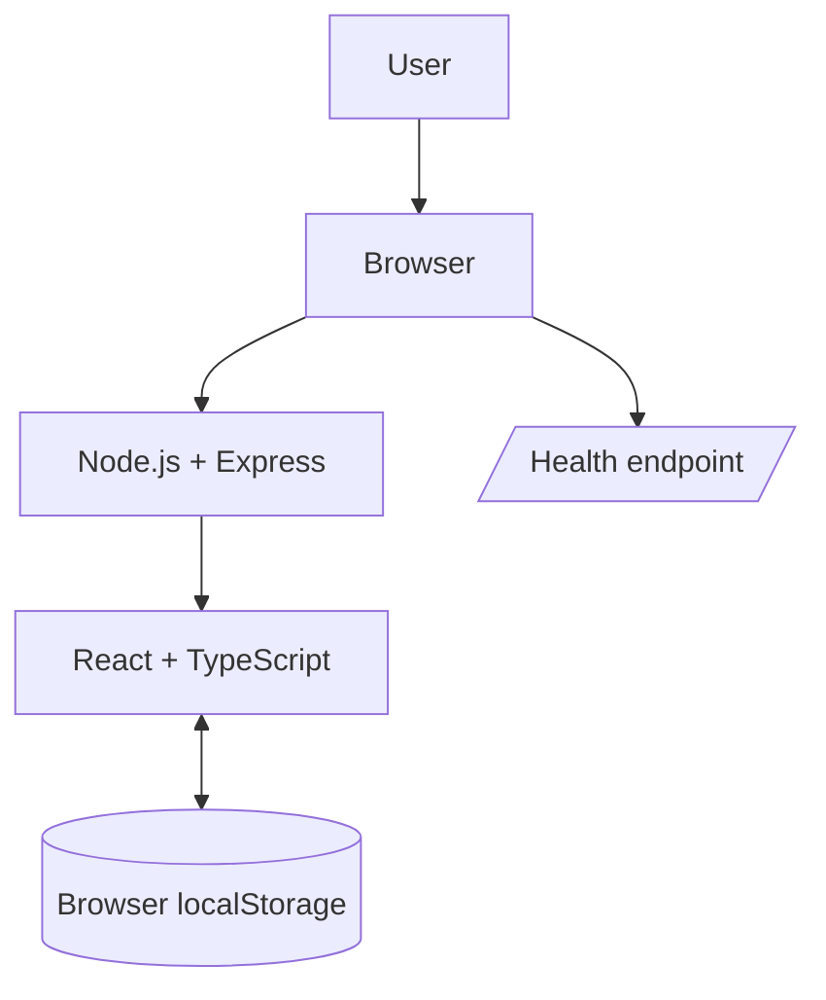
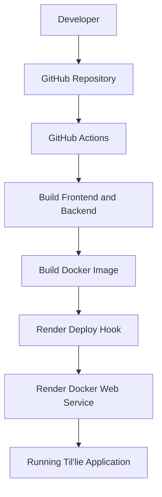
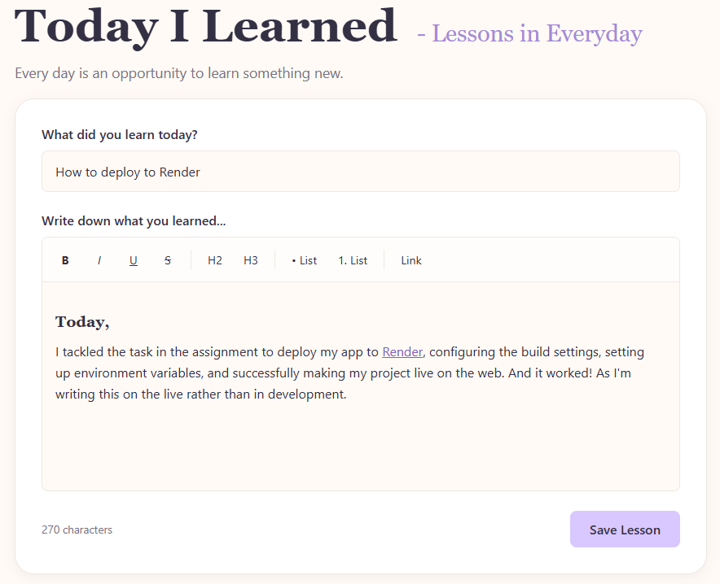
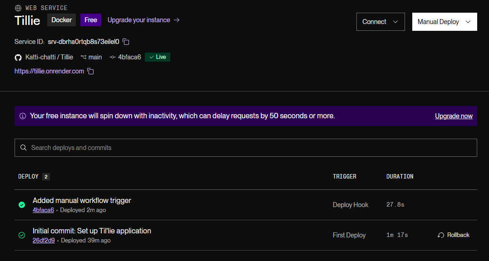
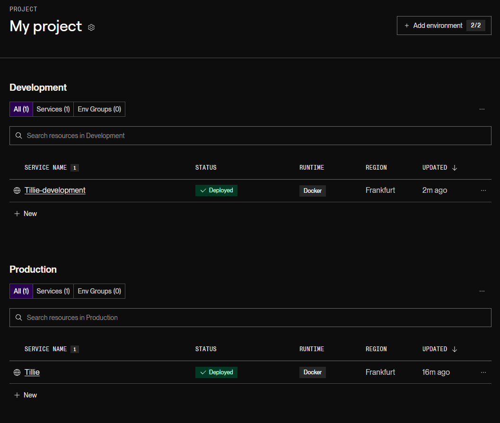
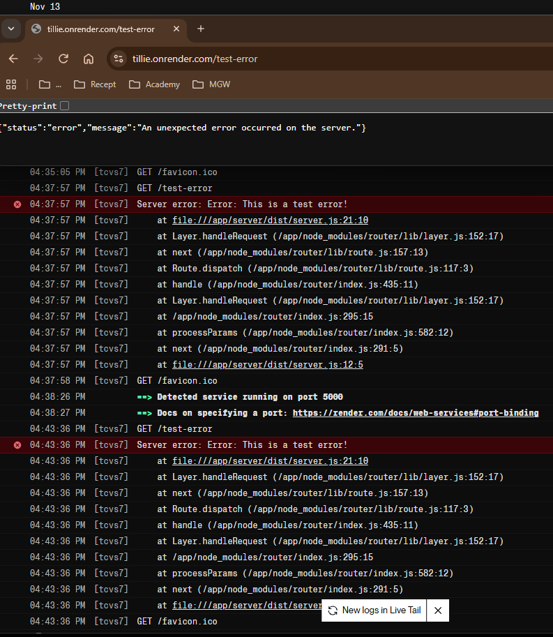

# Til'lie – Today I Learned, Lessons in Everyday

Til'lie is a personal learning journal where you can write, organise and revisit the things you learn in everyday life.

Whether it's something you discovered at work, a new skill, a useful fact or a small everyday realisation, Til'lie gives you a place to save those moments and reflect on what you've learned.

The goal is simple: make everyday learning easier to remember, one lesson at a time.

## Features

- **Create lessons** – Write down new things you've learned using a rich text editor.
- **Read individual lessons** – Open a lesson to view its full content. With more controls like edit and delete.
- **Browse your lessons** – Explore your personal collection in the lesson library.
- **Search lessons** – Find lessons by searching their titles or content.
- **Edit lessons** – Update existing lessons whenever you want. Maybe your information was wrong, or things have changed.
- **Delete lessons** – Remove lessons you no longer want to keep. Things have really changed!
- **Automatic dates** – Keep track of when lessons were created and last updated.
- **Pagination** – Browse your lessons in manageable pages.
- **Local storage** – Your lessons are saved in your browser so they remain available when you return.

## Technologies

### Frontend

- **React**
- **TypeScript**
- **Vite**
- **React Router**
- **Tiptap**
- **DOMPurify**
- **CSS**

### Backend

- **Node.js**
- **Express**
- **dotenv**

### Development and Deployment

- **Git & GitHub**
- **Docker**
- **GitHub Actions**
- **Render**

## Framework Choices and Motivation

Til'lie was built using React and TypeScript with Vite as the frontend development and build tool.

- **React** was chosen to build a component-based user interface, making the application easier to organise and maintain.
- **TypeScript** adds static typing, helping catch errors during development and improving code reliability.
- **Vite** provides a fast development environment and an efficient production build.
- **React Router** handles navigation between the application's different pages.
- **Express** was chosen to provide a lightweight Node.js server that serves the production frontend and provides the health check endpoint.
- **Docker** packages the application and its production dependencies into a consistent, portable environment.

## Getting Started

### Prerequisites

Before running Til'lie locally, make sure you have installed:

- [Node.js](https://nodejs.org/)
- [Git](https://git-scm.com/)

### Installation

1. Clone the repository:

   ```bash
   git clone https://github.com/Katti-chatti/Tillie.git
   ```

2. Navigate to the project folder:

   ```bash
   cd Tillie
   ```

3. Install dependencies:

   ```bash
   npm install
   ```

4. Create a `.env` file in the project root, using `.env.example` as a template.

5. Start the frontend development server:

   ```bash
   npm run dev
   ```

6. In a separate terminal, start the backend development server:

   ```bash
   npm run dev:server
   ```

The frontend and backend run separately during development. The frontend uses Vite, while Express runs the backend server.

## Environment Variables

Create a `.env` file in the project root based on `.env.example`:

```env
NODE_ENV=development
PORT=5000
```

In production, environment variables are configured through the hosting platform instead of using a local `.env` file.

### Secret Management

- Locally, environment variables are stored in `.env`, which is excluded from version control through `.gitignore`.
- The `.env.example` file provides a template showing which variables are required, without containing actual secrets.
- In GitHub Actions, sensitive values such as the Render Deploy Hook URL are stored as GitHub Actions secrets.
- In production, environment variables are configured through Render's environment settings.

This keeps sensitive information separate from the application code and repository.

## Logging, Health Check & Security

### Logging

The server uses `console.info()` to log:

- When the server starts, including its running mode and port.
- Incoming HTTP requests, including their method and URL.

Errors are logged using `console.error()`, which records server errors to help with debugging.

When deployed on Render, these logs are available through the service's log viewer.

### Health Check

The server provides a `/health` endpoint that can be used to check whether the application server is running.

A successful request to `/health` returns an HTTP 200 status code and a JSON response confirming that the server is running.

### Security

Several measures have been implemented to improve the security of the application and its deployment process:

- Environment variables are stored locally in `.env` and are excluded from version control through `.gitignore`.
- The `.env.example` file documents the required configuration without exposing secret values.
- GitHub Actions uses repository secrets to store the Render Deploy Hook URLs.
- The Docker production container runs as a non-root user to reduce unnecessary privileges.
- DOMPurify is used to sanitize rich-text content before it is rendered in the application.
- Production dependencies are installed separately from development dependencies.

## Running with Docker

### Build the Docker image

From the project root, run:

```bash
docker build -t tillie .
```

### Run the container

```bash
docker run --name tillie-container -p 5000:5000 tillie
```

The application will then be available at:

http://localhost:5000

### Stop the container

```bash
docker stop tillie-container
```

### Remove the container

```bash
docker rm tillie-container
```

The Dockerfile uses a multi-stage build to separate the build environment from the production image. This keeps development dependencies and build tools out of the final container.

## Deployment and CI/CD

Til'lie is deployed as a Docker Web Service on [Render](https://render.com/).

GitHub Actions automates the build and deployment process whenever changes are pushed to the `main` branch.

### Deployment workflow

1. Changes are pushed to the `main` branch on GitHub.
2. GitHub Actions installs the project dependencies.
3. The frontend and backend production builds are generated.
4. Docker builds the production image.
5. GitHub Actions triggers a deployment on Render using a Deploy Hook.

### Deployment configuration

- **Hosting:** Render Docker Web Service.
- **Containerisation:** Docker multi-stage build.
- **CI/CD:** GitHub Actions.
- **Deployment trigger:** Render Deploy Hook.
- **Auto-Deploy:** Disabled in Render to let GitHub Actions control deployments.

## Architecture

### Application architecture



### Deployment architecture



## Data Storage

Til'lie uses the browser's localStorage to store lessons. No external database is required.

Lessons are stored locally in the browser where they were created. They are not synchronised between devices or browsers.

## Live Application

**Live URL for Production:** [Til'lie](https://tillie.onrender.com/)

**Live URL for Development:** [Til'lie Dev](https://tillie-development.onrender.com/)

## Cost and Hosting Considerations

1. **Render plan:** Free plan.
2. **Why:** It is sufficient for a small project and avoids unnecessary hosting costs.
3. **Cost factors:** Usage, server resources, storage and traffic.
4. **Reducing resource usage:** Keep the application lightweight, optimise assets and avoid unnecessary server requests.
5. **Limitations:** The free instance spins down after inactivity, which can cause slower initial loading. Lessons are stored locally and are not synchronised between devices.
6. **Future scaling:** More users may require a paid plan, increased server resources and a database for shared data storage.

## Screenshots










## Future Improvements

If Til'lie were to grow beyond its current scope, several improvements could be introduced:

- **Database integration:** Store lessons in a database instead of browser localStorage.
- **User authentication:** Allow users to create accounts and access their lessons securely.
- **Data synchronisation:** Make lessons available across multiple devices.
- **Automated testing:** Add tests to the GitHub Actions pipeline to catch potential issues before deployment.
- **Scalability:** Upgrade hosting resources when increased traffic or usage requires it.
